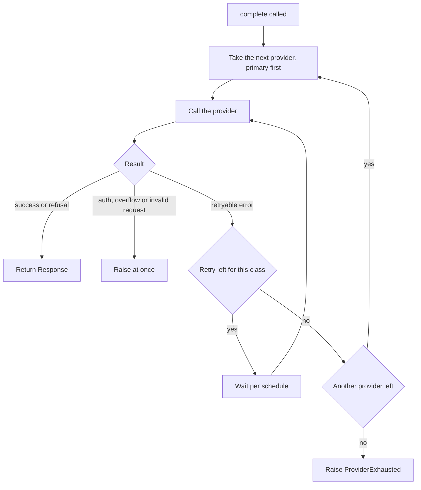

# Requirements: llm-adapter

Status: draft for v1. The owner made the decisions below on 2026-11-09. The owner has not yet approved this document.

Source: `docs/handoff-from-llm-gateway-2026-11-09.md`. The handoff is frozen history. Edit this file, not the handoff.

Vocabulary: see `GLOSSARY.md`.

## Purpose and scope

### What it does

- **One interface.** Callers name a model alias (`default`, `deep`, `planner`) and send a `Request`. They never name a vendor SDK or a model ID. Aliases map to a primary and an optional fallback provider in config, so swapping a model is a config edit.
- **Providers.** It covers Anthropic, OpenAI, Gemini and a custom HTTP endpoint such as a local model server. It wraps each provider's SDK directly (ADR-0003, no LiteLLM).
- **The core owns the policy.** The core applies a per-error-class retry schedule, then fails over to the fallback. When both providers fail, it raises `ProviderExhausted` once and nothing retries in the background. Auth errors are never retried or failed over.
- **Visible outcomes.** Each `Response` carries an `attempts[]` list, so failover is visible. `on_usage` fires once per attempt, including failed ones, with token counts only. That feeds `token-ledger`.
- **Adapters stay thin.** Each adapter only maps one SDK to the shared types and classifies its exceptions. Adding a provider means one file and one config entry.

### What it is not

- It is not a proxy, gateway server or daemon, and that is a hard requirement.
- It has no agent loops, tool execution, prompt building, memory, spend limits or caching.
- It is not used by Coding Workers or Reviewers, because the external CLI harnesses bypass it.

Note: decision D3 refines the "Providers" line. Gemini goes through the OpenAI SDK, with its own base URL and key variable. Version 1 has no Gemini SDK. Section 10 lists what version 1 leaves out.

## Decisions

| ID | Decision | Choice | Date |
|----|----------|--------|------|
| D1 | Name | `llm-adapter` (package `llm_adapter`) | 2026-11-09 |
| D2 | Streaming in v1 | No. Streaming is in v2. | 2026-11-09 |
| D3 | Gemini path | The Responses wire format on the Gemini base URL, through the OpenAI SDK. No native Gemini SDK in v1. See `docs/adr/0001-gemini-through-the-responses-wire.md`. | 2026-11-09 |
| D4 | Where the project rules live | `AGENTS.md`, adapted from agent-garage | 2026-11-09 |
| D5 | Python version | 3.11 or later (default, not vetoed) | 2026-11-09 |
| D6 | Operations in v1 | `complete`, `on_usage` and `validate`. All other operations are in v2. | 2026-11-09 |
| D7 | Call style | `complete` blocks. There is no async form in v1. | 2026-11-09 |
| D8 | Tool calling | v2. Version 1 is text in and text out. | 2026-11-09 |
| D9 | Wire formats | Anthropic: messages. OpenAI: Responses. Gemini: Responses. | 2026-11-09 |
| D10 | Provider settings | The base URL and the key variable name come from config. There are no default names. An unset variable is a `ConfigError` at `validate()`. | 2026-11-09 |
| D11 | Retry counters | One counter for each error class and each provider. The fallback starts with fresh counters. | 2026-11-09 |
| D12 | Auth error | On any provider, raise `AuthError` at once. It carries `attempts[]`. | 2026-11-09 |
| D13 | Context overflow | Raise at once. Do not fail over. | 2026-11-09 |
| D14 | Usage that a provider does not report | The library does not count it and does not estimate it (ADR-0005). | 2026-11-09 |
| D15 | Deadline and cancel | Version 1 has neither. Section 5 gives the worst-case time. | 2026-11-09 |
| D16 | Source of truth | This file. The handoff is frozen. | 2026-11-09 |
| D17 | Alias `planner` | Keep it in the table with no fallback. No default role uses it. | 2026-11-09 |
| D18 | Allowed models | `validate()` rejects an alias whose model is not in `allowed_models`. | 2026-11-09 |

## 1. Interface

Version 1 has three operations.

| Operation | Description |
|---|---|
| `complete(request) -> Response` | Blocking call. It applies the retry and failover policy in section 4. |
| `on_usage(callback)` | Registers a callback. The library calls it once for each attempt, successful or failed. |
| `validate()` | Checks the configuration at startup. It raises `ConfigError`. |

Rules:

- `complete` blocks until it returns or raises.
- `complete` has no per-call deadline and no cancel.
- `complete` raises `ConfigError` for an alias that is not in the alias table.
- `validate()` checks three things. Each alias has a primary provider. The model of each alias is in `allowed_models`. Each environment variable that the config names is set.
- `validate()` names a missing variable in its error. It never prints a value.

## 2. Data model

```
Request:    { alias, messages[], max_output_tokens?, temperature?, system?, metadata{} }
Response:   { text, stop_reason, usage, model_used, provider_used, attempts[] }
Usage:      { input_tokens, output_tokens, cached_input_tokens?, cache_write_tokens? }
Attempt:    { provider, model, outcome, latency_ms }
UsageEvent: { alias, provider, model, usage?, latency_ms, outcome }
```

- `messages[]` holds text only in v1. The sources show no caller that sends images or files.
- `attempts[]` lists every provider call in order, with its outcome. Failover is visible to the caller.
- `outcome` is `success` or the name of the error class.
- `usage` is absent from a `UsageEvent` when the provider reports none (D14).
- The cached-token fields are optional because providers report them in different ways.
- A consumer that records totals adds only `input_tokens` and `output_tokens`.

## 3. Alias table and provider config

The alias table and the provider settings are configuration, not code. This sample shows the shape. The file name and location are open (section 11).

```yaml
providers:
  anthropic:
    wire_api: anthropic-messages
    base_url: "${ANTHROPIC_BASE_URL}"
    api_key_env: ANTHROPIC_AUTH_TOKEN
  openai:
    wire_api: responses
    base_url: "${OPENAI_BASE_URL}"
    api_key_env: OPENAI_API_KEY
  gemini:
    wire_api: responses
    base_url: "${GOOGLE_GEMINI_BASE_URL}"
    api_key_env: GEMINI_API_KEY

allowed_models:
  - "${ANTHROPIC_MODEL}"
  - "<model id>"

aliases:
  default:
    primary:  { provider: anthropic, model: "${ANTHROPIC_MODEL}" }
    fallback: { provider: openai,    model: "<model id>" }
  deep:
    primary:  { provider: anthropic, model: "${ANTHROPIC_MODEL}" }
    fallback: { provider: openai,    model: "<model id>" }
  planner:
    primary:  { provider: anthropic, model: "${ANTHROPIC_MODEL}" }
    fallback: null
```

Rules:

- Replacing a provider or a model is a config edit. It needs no code change and no rebuild.
- No model ID appears in code, in tests or in this file. The sample uses `<model id>`.
- `api_key_env` is the name of an environment variable. A key value never appears in config.
- `${VAR}` is read from the environment when the config loads. An unset variable is a `ConfigError` (D10).
- Every model in an alias must be in `allowed_models` (D18).
- `planner` has no fallback (D17).

## 4. Error classes and policy

| Class | Trigger | Policy |
|---|---|---|
| `rate_limited` | HTTP 429 | Wait 5 s, 15 s and 45 s between retries. Honour `Retry-After`. Then fail over. |
| `server_error` | HTTP 5xx | Retry 3 times with no wait. Then fail over. |
| `timeout` | No response within `timeout`. The default is 30 s. | Retry 2 times. Then fail over. |
| `auth` | HTTP 401 or 403 | Never retry. Never fail over. Raise `AuthError` at once. |
| `context_overflow` | The prompt is over the model limit. | Do not retry. Do not fail over. Raise `ContextOverflow`. The caller shrinks the input. |
| `invalid_request` | HTTP 400 | Do not retry. Raise at once. |
| `content_filtered` | Refusal or safety stop | Do not retry. Return a `Response` with `stop_reason=refusal`. |

Rules:

- Each error class has its own retry counter for each provider (D11).
- When a class has no retries left and fails again, the library fails over.
- The fallback starts with fresh counters.
- An `auth` error on any provider raises `AuthError` at once. It carries `attempts[]` (D12).
- A `context_overflow` error raises at once, even when the fallback has a larger limit (D13).
- A consumer can express this taxonomy as `error-classifier` catalog entries. The library does not depend on `error-classifier`.

## 5. Behaviour



Figure 1. Retry and failover in `complete`.

The library calls each provider in turn. It retries a retryable error while the class counter allows. It then moves to the fallback, or it raises `ProviderExhausted`.

Rules:

- **Usage events.** Every call to a provider fires `on_usage` once, whether the call succeeds or fails.
- **No blind retry loops.** After `ProviderExhausted`, nothing retries in the background. Recovery is the decision of the caller or a person.
- **SDK retries are off.** Each adapter builds its SDK client with the SDK's own retries turned off. Otherwise the SDK retries stack on the library schedule. A test proves it (AT-6).
- **Resume after failover.** The library does not rebuild context. The caller sends the conversation again.
- **Unreported usage.** A call that returns no usage leaves no usage figure. The library does not estimate one (D14).

SDK retry defaults, as the handoff recorded them on 2026-11-09: `anthropic` 2.6.0 retries 2 times, and `openai` 3.46.0 retries 2 times. Check both again when the versions are pinned.

Worst-case time of one `complete` call:

- One provider makes at most 9 calls. That is 1 first call, 3 `rate_limited` retries, 3 `server_error` retries and 2 `timeout` retries.
- The waits for `rate_limited` total 65 s.
- Three `timeout` calls total 90 s.
- One provider takes at most 155 s. Two providers take at most 310 s.
- This figure excludes the response time of calls that return an error. It assumes `Retry-After` does not exceed the schedule (section 11, O3).

## 6. Security

- API keys come from environment variables. They never come from committed files, and they are never logged.
- The library does not log request bodies or response bodies.
- The usage event carries counts only.
- TLS is required for every endpoint that is not on localhost.
- No secret appears in logs, usage events or error messages.

## 7. Failure modes

| Exception | Cause |
|---|---|
| `ProviderExhausted` | Every provider failed with a retryable error. It carries `attempts[]`. |
| `AuthError` | HTTP 401 or 403 from any provider. It carries `attempts[]`. |
| `ContextOverflow` | The prompt is too large. It carries the model limit. |
| `ConfigError` | An unknown alias, an unset variable, or a model that is not in `allowed_models`. |

The sources name no exception for `invalid_request` (section 11, O2). A refusal is not an exception. The library returns it with `stop_reason=refusal`.

## 8. Acceptance criteria

### 8.1 Checklist

| # | Criterion | Status in v1 |
|---|---|---|
| 1 | Anthropic, OpenAI, Gemini and a custom HTTP endpoint | Required. The custom endpoint wire format is open (O1). |
| 2 | Unified tool calling and streaming | v2 (D2, D8) |
| 3 | Per-class retry schedule (section 4), configurable | Required |
| 4 | Ordered fallback with a visible attempts list | Required |
| 5 | Usage callback with input, output and cached tokens | Required |
| 6 | Auth errors never retried or failed over | Required |
| 7 | Circuit breaker | v2 |
| 8 | Client-side TPM and RPM limiting | v2 |
| 9 | No proxy server process | Required, not only preferred |
| 10 | Active maintenance and a permissive licence | Required. No one has checked it yet. |

### 8.2 Behaviour tests

No test exists yet. The names are proposed. AT-1 to AT-5 come from the handoff. AT-6 to AT-9 come from the decisions in this file. Every test runs against a mock server and needs no real key.

| ID | Proposed name | What it proves |
|---|---|---|
| AT-1 | `test_error_sequence_matches_schedule` | A mock server returns 429, 5xx, timeout and 401 in turn. The attempts list and the total wait match section 4. The 401 is never retried. |
| AT-2 | `test_exhaustion_raises_once` | When every provider fails, the library raises once and makes no further call. |
| AT-3 | `test_usage_event_per_attempt` | `on_usage` fires for every attempt, failed ones included, with the right provider and model. |
| AT-4 | `test_model_change_is_config_only` | A model change in config needs no code change and no rebuild. |
| AT-5 | `test_no_secret_in_output` | A canary key does not appear in logs, usage events or error messages. |
| AT-6 | `test_sdk_retries_disabled` | Each adapter builds its SDK client with the SDK's own retries off. |
| AT-7 | `test_auth_error_on_fallback_raises_auth_error` | The primary fails with 5xx and the fallback returns 401. The library raises `AuthError` with `attempts[]`. |
| AT-8 | `test_context_overflow_does_not_fail_over` | A prompt that overflows the primary raises `ContextOverflow`. The library does not call the fallback. |
| AT-9 | `test_validate_rejects_bad_config` | `validate()` raises `ConfigError` for an unset variable, an unknown alias and a model outside `allowed_models`. |

The handoff also had a test for an open circuit breaker. That test moves to v2 with the breaker.

## 9. Callers

Only Python code in UMAS calls the library. The first six rows are from section 3 of the handoff.

| Caller | Operations used | Source |
|---|---|---|
| Coordinator, Router | `complete` | orchestration-spec line 215 |
| Triage Agent | `complete` | monitoring-spec line 118 |
| Patrol (Coordinator-side model calls) | `complete` | A.4.8 table, TECHNICAL-DESIGN-SPEC |
| Non-editing Specialists (open) | `complete` | agent-execution-spec line 248, Open 7 |
| Usage glue to `token-ledger` | `on_usage` | models-and-usage-spec lines 112 to 114 |
| Startup check | `validate()` | models-and-usage-spec line 258 |

Coding Workers and Reviewers run as external CLI harnesses. They bypass the library (A.4.8, TECHNICAL-DESIGN-SPEC).

A research agent read the source repo on 2026-11-09. It reported these facts. No assessor has checked them yet.

- `default` is the alias for every role. `deep` is the alias of the Architect. No default role uses `planner`.
- No documented caller passes tools or sends images. The coordination calls are "one prompt in, one answer out".
- `token-ledger` records `{v, ts, model, tokens}`. It records no actor, project or task. No attribution flows from the request to the usage event.
- The sources do not say whether the callers run concurrently in one process (section 11, O5).

## 10. Deferred to v2

- `stream`: a first-token timeout, an error event for a mid-stream failure, and no restart of a partly delivered stream on another provider.
- Tool calling: `tools[]`, `tool_calls[]` and the shape of a tool-result message.
- `health()`: the last-seen status of each provider.
- `provider_override` in the request.
- Circuit breaker: after 5 consecutive failures, a provider is open for 60 s. One probe then decides whether to close it.
- Client-side rate limiting: token buckets for each provider and alias. The wait is at most 30 s, then `RateLimitedLocal`.
- An async form of `complete`.
- Cancel of a call in progress.
- A per-call deadline.
- A native Gemini SDK, if a Gemini-only feature is needed.

## 11. Open items

The grilling session did not settle these items. Each one needs an owner decision before the spec is final.

| ID | Item |
|----|------|
| O1 | The wire format of the custom HTTP endpoint. It can be chat completions or Responses. The sources do not say. |
| O2 | The exception for `invalid_request`. The sources name none. |
| O3 | `Retry-After` can exceed the 5 s, 15 s and 45 s schedule. The sources set no cap. |
| O4 | `metadata{}` in the request. No v1 caller or consumer uses it. Keep it or drop it. |
| O5 | Thread safety. The sources do not say whether callers run concurrently in one process. |
| O6 | The config file name and location. The handoff also allows a secrets provider. D10 names only environment variables. |
| O7 | Gemini through the Responses wire is unverified. No spike checked its usage fields. |
| O8 | Whether Specialists use the library. This is Open 7 in the agent-execution spec. |
