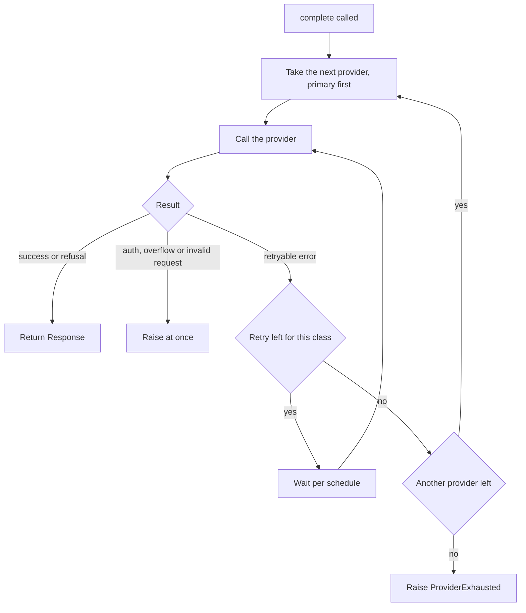

# Requirements: llm-adapter

Status: draft for v1. The owner made decisions D1 to D18 and answered open items O1 to O12 (decisions D19 to D30) on 2026-11-09. The owner approved this document as a whole on 2026-11-09. Some items stay unverified, such as the context-overflow bodies that real servers send. Section 11 lists the rest.

Vocabulary: see `GLOSSARY.md`.

## Purpose and scope

### What it does

- **One interface.** Callers name a model alias (`default`, `deep`, `planner`) and send a `Request`. They never name a vendor SDK or a model ID. Aliases map to a primary and an optional fallback provider in config, so swapping a model is a config edit.
- **Providers.** Version 1 covers Anthropic, OpenAI and Gemini. A custom HTTP endpoint such as a local model server is in v2 (D19). It wraps each provider's SDK directly. It does not use a multi-provider proxy library.
- **The core owns the policy.** The core applies a per-error-class retry schedule, then fails over to the fallback. When both providers fail, it raises `ProviderExhausted` once and nothing retries in the background. Auth errors are never retried or failed over.
- **Visible outcomes.** Each `Response` carries an `attempts[]` list, so failover is visible. `on_usage` fires once per attempt, including failed ones, with token counts only. A caller can feed that to a usage ledger.
- **Adapters stay thin.** Each adapter only maps one SDK to the shared types and classifies its exceptions. Adding a provider means one file and one config entry.

### What it is not

- It is not a proxy, gateway server or daemon, and that is a hard requirement.
- It has no agent loops, tool execution, prompt building, memory, spend limits or caching.
- It is not used by external CLI coding harnesses, because they bypass it.

Note: decision D3 refines the "Providers" line. Gemini goes through the OpenAI SDK, with its own base URL and key variable. Version 1 has no Gemini SDK. Section 10 lists what version 1 leaves out.

## Decisions

| ID | Decision | Choice | Date |
|----|----------|--------|------|
| D1 | Name | `llm-adapter` (package `llm_adapter`) | 2026-11-09 |
| D2 | Streaming in v1 | No. Streaming is in v2. | 2026-11-09 |
| D3 | Gemini path | The Responses wire format on the Gemini base URL, through the OpenAI SDK. No native Gemini SDK in v1. See `docs/adr/0001-gemini-through-the-responses-wire.md`. | 2026-11-09 |
| D4 | Where the project rules live | `AGENTS.md` | 2026-11-09 |
| D5 | Python version | 3.11 or later (default, not vetoed) | 2026-11-09 |
| D6 | Operations in v1 | `complete`, `on_usage` and `validate`. All other operations are in v2. | 2026-11-09 |
| D7 | Call style | `complete` blocks. There is no async form in v1. | 2026-11-09 |
| D8 | Tool calling | v2. Version 1 is text in and text out. | 2026-11-09 |
| D9 | Wire formats | Anthropic: messages. OpenAI: Responses. Gemini: Responses. | 2026-11-09 |
| D10 | Provider settings | The base URL and the key variable name come from config. There are no default names. An unset variable is a `ConfigError` at `validate()`. | 2026-11-09 |
| D11 | Retry counters | One counter for each error class and each provider. The fallback starts with fresh counters. | 2026-11-09 |
| D12 | Auth error | On any provider, raise `AuthError` at once. It carries `attempts[]`. | 2026-11-09 |
| D13 | Context overflow | Raise at once. Do not fail over. | 2026-11-09 |
| D14 | Usage that a provider does not report | The library does not count it and does not estimate it. The library tracks token usage only. | 2026-11-09 |
| D15 | Deadline and cancel | Version 1 has neither. Section 5 gives the worst-case time. | 2026-11-09 |
| D16 | Source of truth | This file. | 2026-11-09 |
| D17 | Alias `planner` | Keep it in the table with no fallback. No default role uses it. | 2026-11-09 |
| D18 | Allowed models | `validate()` rejects an alias whose model is not in `allowed_models`. | 2026-11-09 |
| D19 | Custom HTTP endpoint (O1) | Not in v1. No v1 caller or alias uses it. In v2 it uses the chat completions wire, with `wire_api` set in config. | 2026-11-09 |
| D20 | `invalid_request` (O2) | Raise `InvalidRequest` at once. It carries `attempts[]`. No retry, no failover. | 2026-11-09 |
| D21 | `Retry-After` (O3) | Honour it up to 60 s. The wait is the larger of the schedule step and `Retry-After`. A larger value fails over at once, with no wait. | 2026-11-09 |
| D22 | `metadata{}` (O4) | Dropped from the v1 `Request`. | 2026-11-09 |
| D23 | Thread safety (O5) | `complete` is safe to call from several threads. | 2026-11-09 |
| D24 | Config loading (O6) | YAML. The caller passes the file path to `load_config(path)`. There is no search path and no secrets provider in v1. | 2026-11-09 |
| D25 | Gemini usage fields (O7) | Map the Responses usage fields. When a field is missing, leave usage absent (D14). The live check (T4) confirmed the fields on 2026-11-09. | 2026-11-09 |
| D26 | Specialists (O8) | Not blocking. If specialist agents use the library, they use `complete` with the `default` alias, so v1 does not change. | 2026-11-09 |
| D27 | Spent-quota 429 (O9) | No separate class. Every 429 follows the `rate_limited` schedule in section 4. | 2026-11-09 |
| D28 | Other HTTP statuses (O10) | 408 is `timeout`. 409 and 529 are `server_error`. 422 and 404 are `invalid_request` (D41). 413 is a `context_overflow` when the body says so, else `invalid_request`. | 2026-11-09 |
| D29 | `Retry-After` forms (O11) | Read `retry-after-ms`, then seconds, then an HTTP date. The 60 s cap of D21 applies to all three. A value that cannot be parsed is ignored, and the schedule step applies. | 2026-11-09 |
| D30 | SDK clients and threads (O12) | Each thread builds and keeps its own SDK client. No client is shared between threads. | 2026-11-09 |
| D31 | Mock for tests | `httpx2.MockTransport`, passed to each SDK client as its `http_client`. It adds no dependency and opens no port. An adapter builder accepts an optional `http_client` for this. Default taken, not vetoed. | 2026-11-09 |
| D32 | Dependency pins | Latest release on PyPI at the time of the check, unless it cannot be used. Approved on 2026-11-09: `anthropic` 2.6.0, `openai` 3.46.0, `PyYAML` 6.0.3, `httpx2` 2.16.0. | 2026-11-09 |
| D33 | Context window per alias (O13) | Each alias has a `context_window`, in tokens, in config. `validate()` raises `ConfigError` for an alias that has none. | 2026-11-09 |
| D34 | Prompt-size pre-check (O13) | Before any provider call, `complete` estimates the prompt size locally and compares it with the alias's `context_window`. The estimate is the number of characters of `system` and of every message, divided by 4, with 10% headroom (D37), and rounded up. It adds no dependency. When the estimate is over the window, `complete` raises `ContextOverflow` at once (section 4, D13): no provider call, no `Attempt`, no `on_usage` event, no failover. The estimate is not a usage figure (D14). The module is `precheck.py`. `complete` (B4) calls it. | 2026-11-09 |
| D35 | `context_window` values | `default` and `deep` are set to 272000 tokens. `planner` is set to 1000000 tokens. Their primary is `${ANTHROPIC_MODEL}`, whose limit the gateway's Models API reports as 1000000 for `claude-advantage-assist` (read on 2026-11-09). A shared window is the smaller of the primary's and the fallback's limits (D35). The fallback of `default` and `deep` is `<model id>` in the sample, unmapped in the repo. The owner chose 272000, the smallest `max_input_tokens` the gateway reports for a GPT model (`gpt-5.1`, read on 2026-11-09), so the window holds for any GPT fallback. A fallback pinned to `gpt-advantage-assist` (1000000) would allow 1000000. | 2026-11-09 |
| D36 | Connection errors (O14) | A refused, reset or otherwise failed connection, with no HTTP response, is class `timeout`. It retries 2 times, then fails over. Both adapters do this. Section 4 had no class for it. | 2026-11-09 |
| D37 | Pre-check headroom (O13) | The estimate adds 10% headroom: `ceil(characters * 110 / 400)`, an integer calculation. The estimate counts characters divided by 4, and that undercounts code and non-English text. The owner approved this on 2026-11-09 as recommended. | 2026-11-09 |
| D38 | Usage callback errors | An exception raised inside an `on_usage` callback is caught. The library logs the exception type only, never its message, and returns the response. A broken observer does not lose a good response or a usage event that was already recorded. Approved 2026-11-09 as recommended. | 2026-11-09 |
| D39 | Non-SDK exceptions in `classify` | When `classify` gets an exception that is not from its SDK, it re-raises that exception as it is. It does not convert it to `TypeError`. Both adapters do this. A non-SDK exception is a bug in the caller or the library, so it should not be hidden. Approved 2026-11-09 as recommended. | 2026-11-09 |
| D40 | Core factory | `build_core(config, adapters)` builds a `Core` from a `Config`. `build_adapters(config, http_client)` builds one adapter per provider from its `wire_api`. `Core.complete` stays the entry point, and `build_core` is the way to construct it from configuration. Approved 2026-11-09 as recommended. | 2026-11-09 |
| D41 | HTTP 404 | A 404 is `invalid_request`. It is raised at once, with no retry and no failover (D20). Both adapters do this. Approved 2026-11-09 as recommended. | 2026-11-09 |
| D42 | Anthropic default `max_tokens` (section 2) | When the caller gives no `max_output_tokens`, the Anthropic adapter sends `max_tokens` 4096, because the Messages API requires the field. The value is the smallest safe default. Approved 2026-11-09 as recommended. | 2026-11-09 |
| D43 | SDK drift check | One test file, `tests/test_sdk_drift.py`, asserts the SDK facts this spec rests on: the default retry count, the error types `classify` maps, and the usage fields the adapters read. It runs in the existing CI. A pin bump that moves one of them fails its PR. No separate job, and no key in CI. Approved 2026-11-09. | 2026-11-09 |
| D44 | Specialist tools | A specialist is given the tools it needs, and the set is configurable. This is a requirement for v2 tool calling (D8), not for v1. Until then, a specialist that needs a tool cannot use the library. The config shape for a per-specialist tool set is not designed. Stated by the owner 2026-11-09. | 2026-11-09 |
| D45 | Gemini overflow body | Accepted as an unverified risk. The Gemini overflow markers stay guesses. The pre-check (D34) rejects a prompt over the alias's window before any call, so the provider reply is a second line of defence. Approved 2026-11-09. | 2026-11-09 |
| D46 | CI platforms | CI runs the checks on Linux, Windows and macOS. Approved 2026-11-09. | 2026-11-09 |

## 1. Interface

Version 1 has three operations.

| Operation | Description |
|---|---|
| `complete(request) -> Response` | Blocking call. It applies the retry and failover policy in section 4. |
| `on_usage(callback)` | Registers a callback. The library calls it once for each attempt, successful or failed. |
| `validate()` | Checks the configuration at startup. It raises `ConfigError`. |

Rules:

- `complete` blocks until it returns or raises.
- `complete` has no per-call deadline and no cancel.
- `complete` is safe to call from several threads (D23). The counters of D11 belong to one call. The `on_usage` callback runs on the thread that called `complete`, and the callback list is guarded. Each thread uses its own SDK client, so the library does not depend on SDK thread safety (D30). Async callers use `asyncio.to_thread`, because an async form is in v2.
- `load_config(path)` reads the YAML file at `path` and returns the configuration (D24). The library has no default path and no search.
- `complete` raises `ConfigError` for an alias that is not in the alias table.
- `validate()` checks three things. Each alias has a primary provider. The model of each alias is in `allowed_models`. Each environment variable that the config names is set.
- `validate()` names a missing variable in its error. It never prints a value.

## 2. Data model

```
Request:    { alias, messages[], max_output_tokens?, temperature?, system? }
Response:   { text, stop_reason, usage, model_used, provider_used, attempts[] }
Usage:      { input_tokens, output_tokens, cached_input_tokens?, cache_write_tokens? }
Attempt:    { provider, model, outcome, latency_ms }
UsageEvent: { alias, provider, model, usage?, latency_ms, outcome }
```

- `messages[]` holds text only in v1. The sources show no caller that sends images or files.
- `attempts[]` lists every provider call in order, with its outcome. Failover is visible to the caller.
- `outcome` is `success` or the name of the error class.
- `usage` is absent from a `UsageEvent` when the provider reports none (D14).
- `max_output_tokens` has no default in this section. The Anthropic Messages API requires `max_tokens`, so the Anthropic adapter sends 4096 when the caller gives none (D42).
- The `Request` has no `metadata{}` in v1 (D22). Adding a field later does not break callers.
- The cached-token fields are optional because providers report them in different ways.
- Usage field names, read from the pinned SDK source (T3, verified by reading, not run). Anthropic: `usage.input_tokens`, `usage.output_tokens`, `usage.cache_read_input_tokens` and `usage.cache_creation_input_tokens`. The last two are optional. Responses (OpenAI and Gemini): `usage.input_tokens`, `usage.output_tokens`, `usage.input_tokens_details.cached_tokens` and `usage.input_tokens_details.cache_write_tokens`. `Response.usage` is optional on the Responses wire. When the SDK gets no usage, it sets `None` and does not raise, unless strict response validation is on (D14).
- Gemini usage (D25): the adapter reads `input_tokens`, `output_tokens` and `input_tokens_details.cached_tokens` from the Responses usage object. A missing field leaves usage absent. The live check on 2026-11-09 (T4) found all three as integers on the configured Gemini endpoint. `input_tokens_details.cache_write_tokens` was absent, so `cache_write_tokens` stays unset for Gemini. The endpoint also returns `output_tokens_details.reasoning_tokens`. v1 does not map it. A non-zero cached count was not seen.
- A consumer that records totals adds only `input_tokens` and `output_tokens`.

## 3. Alias table and provider config

The alias table and the provider settings are configuration, not code. This sample shows the shape. The file is YAML. The caller passes its path to `load_config(path)` (D24). The file name is the caller's choice.

```yaml
providers:
  anthropic:
    wire_api: anthropic-messages
    base_url: "${ANTHROPIC_BASE_URL}"
    api_key_env: ANTHROPIC_AUTH_TOKEN
  openai:
    wire_api: responses
    base_url: "${OPENAI_BASE_URL}"
    api_key_env: OPENAI_API_KEY
  gemini:
    wire_api: responses
    base_url: "${GOOGLE_GEMINI_BASE_URL}"
    api_key_env: GEMINI_API_KEY

allowed_models:
  - "${ANTHROPIC_MODEL}"
  - "<model id>"

aliases:
  default:
    context_window: 272000  # smallest GPT limit the gateway reports (D35)
    primary:  { provider: anthropic, model: "${ANTHROPIC_MODEL}" }
    fallback: { provider: openai,    model: "<model id>" }
  deep:
    context_window: 272000  # smallest GPT limit the gateway reports (D35)
    primary:  { provider: anthropic, model: "${ANTHROPIC_MODEL}" }
    fallback: { provider: openai,    model: "<model id>" }
  planner:
    context_window: 1000000  # the primary's limit, as the gateway reports it (D35)
    primary:  { provider: anthropic, model: "${ANTHROPIC_MODEL}" }
    fallback: null
```

Rules:

- Replacing a provider or a model is a config edit. It needs no code change and no rebuild.
- No model ID appears in code, in tests or in this file. The sample uses `<model id>`.
- `api_key_env` is the name of an environment variable. A key value never appears in config.
- `${VAR}` is read from the environment when the config loads. An unset variable is a `ConfigError` (D10).
- Every model in an alias must be in `allowed_models` (D18).
- `planner` has no fallback (D17).
- Every alias has a `context_window` in tokens (D33). `validate()` raises `ConfigError` for an alias without one. The value is the model's input limit, as the caller states it. The library does not verify it against the provider.
- `complete` compares an estimate of the prompt with this value before it calls a provider (D34). The values in the sample come from the gateway's Models API for the primary (D35). The primary and the fallback of one alias share one `context_window`, so it should be the smaller of the two models' limits. The fallback's limit is unknown (D35).
- Reading YAML needs a parser dependency. The owner approved PyYAML 6.0.3, the latest release on PyPI, on 2026-11-09 (D32). It is installed (B1, 2026-11-09).

## 4. Error classes and policy

| Class | Trigger | Policy |
|---|---|---|
| `rate_limited` | HTTP 429 | Wait 5 s, 15 s and 45 s between retries. Each wait is the larger of the schedule step and `Retry-After`, up to 60 s. `Retry-After` has three forms (D29). When `Retry-After` is over 60 s, fail over at once with no wait (D21). Then fail over. |
| `server_error` | HTTP 5xx, including 529, and HTTP 409 (D28) | Retry 3 times with no wait. Then fail over. |
| `timeout` | No response within `timeout`, a refused or reset connection (D36), or HTTP 408 (D28). The default is 30 s. | Retry 2 times. Then fail over. |
| `auth` | HTTP 401 or 403 | Never retry. Never fail over. Raise `AuthError` at once. |
| `context_overflow` | The prompt is over the model limit, by the local estimate before the call (D34) or by the provider's reply. | Do not retry. Do not fail over. Raise `ContextOverflow`. The caller shrinks the input. |
| `invalid_request` | HTTP 400 that is not a context overflow, HTTP 422, and HTTP 413 that is not a context overflow (D28) | Do not retry. Do not fail over. Raise `InvalidRequest` at once (D20). |
| `content_filtered` | Refusal or safety stop | Do not retry. Return a `Response` with `stop_reason=refusal`. |

Rules:

- Each error class has its own retry counter for each provider (D11).
- When a class has no retries left and fails again, the library fails over.
- The fallback starts with fresh counters.
- An `auth` error on any provider raises `AuthError` at once. It carries `attempts[]` (D12).
- A `context_overflow` error raises at once, even when the fallback has a larger limit (D13).
- The pre-check (D34) runs before the first provider call. An overflow it finds makes no provider call, so it adds no `Attempt` and fires no `on_usage` event. The estimate is rough, so a prompt under the window can still overflow at the provider. The adapter then classifies the reply as `context_overflow` as before.
- An HTTP 413 is a context overflow when the error body says so (D28). The adapter tests for this before it classifies a 413 as `invalid_request`.
- An `invalid_request` error raises `InvalidRequest` at once. It carries `attempts[]` (D20).
- OpenAI and Gemini can return a context overflow as an HTTP 400. An adapter tests for context overflow before it classifies a 400 as `invalid_request`.
- Neither pinned SDK separates a context overflow from any other 400. Both raise `BadRequestError`. The adapter must read the error body (`type`, `code` or `message`) itself, and the error codes that real servers send are not defined in the SDK source. The Anthropic SDK docstring says not to match on message text. Until a fixture shows the real body, the overflow test is unverified (T3).
- The SDK default timeout is 600 s for a read. The adapter passes the `timeout` of 30 s to the SDK explicitly.

## 5. Behaviour



Figure 1. Retry and failover in `complete`.

The library calls each provider in turn. It retries a retryable error while the class counter allows. It then moves to the fallback, or it raises `ProviderExhausted`.

Rules:

- **Usage events.** Every call to a provider fires `on_usage` once, whether the call succeeds or fails.
- **No blind retry loops.** After `ProviderExhausted`, nothing retries in the background. Recovery is the decision of the caller or a person.
- **SDK retries are off.** Each adapter builds its SDK client with the SDK's own retries turned off. Otherwise the SDK retries stack on the library schedule. A test proves it (AT-6).
- **Resume after failover.** The library does not rebuild context. The caller sends the conversation again.
- **Unreported usage.** A call that returns no usage leaves no usage figure. The library does not estimate one (D14).

SDK retry defaults, read from the pinned source on 2026-11-09 (T3, verified by reading, not run): `anthropic` 2.6.0 and `openai` 3.46.0 each retry 2 times by default. Both retry 429, 5xx, 408, 409, timeouts and connection errors. The adapter builds the client with `max_retries=0`, and the retry loop then runs once. A per-request override is `client.with_options(max_retries=0)`. AT-6 checks that one HTTP request is made per attempt. The `openai` websocket `connect()` and the `anthropic` beta runners have their own retry loops. v1 does not use them.

Worst-case time of one `complete` call:

- One provider makes at most 9 calls. That is 1 first call, 3 `rate_limited` retries, 3 `server_error` retries and 2 `timeout` retries.
- With no `Retry-After` header, the waits for `rate_limited` total 65 s. With `Retry-After` at the 60 s cap (D21), each of the 3 waits is at most 60 s, so the waits total at most 180 s.
- Three `timeout` calls total 90 s.
- One provider takes at most 270 s (180 s + 90 s). Two providers take at most 540 s. Without `Retry-After`, the figures are 155 s and 310 s.
- These figures are arithmetic from this section. No test has measured them. They exclude the response time of calls that return an error.

## 6. Security

- API keys come from environment variables. They never come from committed files, and they are never logged.
- The library does not log request bodies or response bodies.
- The usage event carries counts only.
- TLS is required for every endpoint that is not on localhost.
- No secret appears in logs, usage events or error messages.

## 7. Failure modes

| Exception | Cause |
|---|---|
| `ProviderExhausted` | Every provider failed with a retryable error. It carries `attempts[]`. |
| `AuthError` | HTTP 401 or 403 from any provider. It carries `attempts[]`. |
| `ContextOverflow` | The prompt is too large, by the local estimate before the call (D34) or by the provider's reply. It carries the model limit, which is the alias's `context_window` (D33). |
| `InvalidRequest` | HTTP 400 that is not a context overflow. It carries `attempts[]` (D20). |
| `ConfigError` | An unknown alias, an unset variable, a model that is not in `allowed_models`, or an alias with no `context_window` (D33). |

A refusal is not an exception. The library returns it with `stop_reason=refusal`.

## 8. Acceptance criteria

### 8.1 Checklist

| # | Criterion | Status in v1 |
|---|---|---|
| 1 | Anthropic, OpenAI, Gemini and a custom HTTP endpoint | Anthropic, OpenAI and Gemini are required. The custom endpoint is v2 (D19). |
| 2 | Unified tool calling and streaming | v2 (D2, D8) |
| 3 | Per-class retry schedule (section 4), configurable | Required |
| 4 | Ordered fallback with a visible attempts list | Required |
| 5 | Usage callback with input, output and cached tokens | Required |
| 6 | Auth errors never retried or failed over | Required |
| 7 | Circuit breaker | v2 |
| 8 | Client-side TPM and RPM limiting | v2 |
| 9 | No proxy server process | Required, not only preferred |
| 10 | Active maintenance and a permissive licence | Required. No one has checked it yet. |

### 8.2 Behaviour tests

Each test exists under the name below. AT-1 to AT-5 come from the first draft of the requirements. AT-6 to AT-14 come from the decisions in this file. The end-to-end tests are in `tests/test_conformance.py`. Each one loads a YAML file with `load_config`, builds the core with `build_core` and the real adapters, and calls `complete` through a mock HTTP layer (D31). Each one needs no real key. The unit tests for the same behaviour are in `tests/test_core.py` and the adapter test files.

| ID | Proposed name | What it proves |
|---|---|---|
| AT-1 | `test_error_sequence_matches_schedule` | The mock transport returns 429, 5xx, timeout and 401 in turn. The attempts list and the total wait match section 4. The 401 is never retried. |
| AT-2 | `test_exhaustion_raises_once` | When every provider fails, the library raises once and makes no further call. |
| AT-3 | `test_usage_event_per_attempt` | `on_usage` fires for every attempt, failed ones included, with the right provider and model. |
| AT-4 | `test_model_change_is_config_only` | A model change in config needs no code change and no rebuild. |
| AT-5 | `test_no_secret_in_output` | A canary key does not appear in logs, usage events or error messages. |
| AT-6 | `test_sdk_retries_disabled` | Each adapter builds its SDK client with the SDK's own retries off. |
| AT-7 | `test_auth_error_on_fallback_raises_auth_error` | The primary fails with 5xx and the fallback returns 401. The library raises `AuthError` with `attempts[]`. |
| AT-8 | `test_context_overflow_does_not_fail_over` | A prompt that overflows the primary raises `ContextOverflow`. The library does not call the fallback. |
| AT-9 | `test_validate_rejects_bad_config` | `validate()` raises `ConfigError` for an unset variable, an unknown alias and a model outside `allowed_models`. |
| AT-10 | `test_invalid_request_raises_at_once` | A 400 raises `InvalidRequest` with `attempts[]`. The library does not retry and does not call the fallback. A 400 that reports a context overflow raises `ContextOverflow` instead (D13, D20). |
| AT-11 | `test_retry_after_is_capped` | A 429 with `Retry-After` of 20 s waits 20 s. A 429 with `retry-after-ms` or an HTTP date waits the same time (D29). A 429 with `Retry-After` over 60 s fails over at once with no wait (D21). A value that cannot be parsed gives the schedule step. The test uses a fake clock. |
| AT-12 | `test_concurrent_complete_calls_are_independent` | Several threads call `complete` at once. Each call keeps its own counters and `attempts[]`, and `on_usage` fires once per attempt (D23). Each thread uses its own SDK client (D30). |
| AT-13 | `test_load_config_reads_yaml_path` | `load_config(path)` reads the given file and resolves `${VAR}`. It does not search for a file (D24). |
| AT-14 | `test_prompt_over_window_raises_before_any_provider_call` | A prompt whose estimate (with the 10% headroom of D37) is over the alias's `context_window` raises `ContextOverflow` with that limit. The mock transport sees no request, the fallback is not tried, `attempts[]` is empty of provider calls and `on_usage` does not fire (D34). The estimator itself is covered by `tests/test_precheck.py`, which exists. |

The Gemini live check (D25) is not an acceptance test, because a test never calls a real provider. It is `scripts/check_gemini_usage.py`, run by hand with a real key. It records only the names of the usage keys, never values. It passed on 2026-11-09 (T4).

The first draft also had a test for an open circuit breaker. That test moves to v2 with the breaker.

## 9. Callers

Callers are Python code in the host application. They call the library for coordination work. On 2026-11-09 a read-only assessor checked this section against the caller design documents (task T1, rechecked as the build gate). No caller code exists yet, so nothing here is checked against running code.

| Caller | Operations used | Note |
|---|---|---|
| Coordinator | `complete` | |
| Router | a model call, operation not named | The design does not name the operation. Treat it as `complete`. |
| Triage Agent | `complete` | |
| System Patrol | `complete` | Named only in a summary table. No detailed design yet. |
| Project Monitors | `complete` | Named only in a summary table. No detailed design yet. |
| Non-editing specialist agents | `complete` | Decided (D26, D44). They call `complete` with the `default` alias. The owner wants each specialist to be given the tools it needs, set in config. That needs tool calling, which is v2 (D8). |
| Usage glue to the usage ledger | `on_usage` | |
| Startup check | `validate()` | The only call site in the design. |

External CLI coding harnesses call providers on their own. They bypass the library.

Facts, as checked:

- `default` is the alias for every role. `deep` is the alias for architecture work. `planner` has no role by default.
- The coordination calls are one prompt in and one answer out. No caller sends images.
- Tools: a caller's request payload lists `tools[]` as optional. No sample sets it. Tool calling is v2 (D8). The proposed specialist forms give some specialists `read` and `search` tools. Those would need v2. D26 assumes one prompt and one answer.
- Metadata: a caller's request payload lists `metadata{}`, and the caller states that it does not use it. D22 drops the field.
- The usage ledger records `{v, ts, model, tokens}`, with no actor, project or task.
- The usage glue records the `model` or the `alias` of each attempt. The `UsageEvent` carries both, and the caller decides which one it records. AT-3 checks both fields.
- Concurrency: no caller document says whether callers run concurrently in one process. D23 and D30 stand.
- Panel pattern: a caller may send N `complete` calls and then one synthesis call. Each is a separate call, so the library needs no change.
- Failure handling: a caller treats `AuthError` as its highest priority, `ProviderExhausted` as the next, and records a `provider_failed` event. The library's exception classes must stay as section 7 defines them.
- Context window: a caller reads a context window for each alias and raises `ConfigError` when an alias has none. The library now carries the same field and the same `ConfigError` (D33).

## 10. Deferred to v2

- `stream`: a first-token timeout, an error event for a mid-stream failure, and no restart of a partly delivered stream on another provider.
- Tool calling: `tools[]`, `tool_calls[]` and the shape of a tool-result message.
- `health()`: the last-seen status of each provider.
- `provider_override` in the request.
- Circuit breaker: after 5 consecutive failures, a provider is open for 60 s. One probe then decides whether to close it.
- Client-side rate limiting: token buckets for each provider and alias. The wait is at most 30 s, then `RateLimitedLocal`.
- An async form of `complete`.
- Cancel of a call in progress.
- A per-call deadline.
- A native Gemini SDK, if a Gemini-only feature is needed.
- The custom HTTP endpoint, on the chat completions wire (D19).
- A secrets provider as a source for keys, and a config search path (D24).
- `metadata{}` in the request, if a caller needs it (D22).

## 11. Open items

The owner answered O1 to O13 on 2026-11-09. Each answer is a decision in the Decisions table. Some points stay unverified, and the build must not treat them as fact.

| ID | Item | Answer | Still unverified |
|----|------|--------|------------------|
| O1 | Wire format of the custom HTTP endpoint | D19: not in v1. Chat completions in v2. | No caller needs it. |
| O2 | Exception for `invalid_request` | D20: `InvalidRequest` | None |
| O3 | `Retry-After` cap | D21: 60 s cap, then fail over | The worst-case times in section 5 are arithmetic. |
| O4 | `metadata{}` | D22: dropped | None |
| O5 | Thread safety | D23: thread-safe | None. D30 gives each thread its own client. |
| O6 | Config file | D24: YAML, explicit path | None. PyYAML 6.0.3 is approved (D32). |
| O7 | Gemini usage fields | D25: map them, with a live check | Confirmed on the configured endpoint (T4). A non-zero cached count was not seen. |
| O8 | Specialists | D26: not blocking | None |
| O9 | A 429 that does not clear | D27: keep the `rate_limited` schedule. A spent quota costs up to 65 s per provider before failover. | None |
| O10 | Other HTTP statuses | D28: the mapping in section 4 | The overflow phrases are partly verified (F3). |
| O11 | `Retry-After` forms | D29: all three, capped at 60 s | The date form needs a clock. AT-11 covers it. |
| O12 | SDK client thread safety | D30: one client per thread | The cost is one connection pool per thread. Not measured. |
| O13 | Context window per alias | D33: `context_window` per alias, required by `validate()`. D34: `complete` pre-checks the prompt with a local estimate (characters divided by 4) and raises `ContextOverflow`. D35: 272000 for `default` and `deep`, 1000000 for `planner`. The fallback's limit is the one the owner chose the window from (D35). | The fallback model is not named in the repo, so its real limit is unknown (D35). The estimate is rough: it can be off in either direction, and a model's tokenizer is not known to the library. Whether to add a safety margin to the estimate is not decided. |

Live probe of F3 (2026-11-09, one request per provider, a prompt of about 4 MB, 400 or the reply shape recorded, no body text kept):

- Anthropic: HTTP 400, `type` `invalid_request_error`, a message that contains "prompt is too long". Verified. The adapter's phrase is now that one phrase only.
- OpenAI (`gpt-5.1` on the gateway): HTTP 400, `code` "400" (not `context_length_exceeded`), `type` `invalid_request_error`, a message that contains "context window". Verified: the Responses adapter matches "context window". The code marker stays as an unverified guess.
- Gemini (`gemini-3.5-flash`): the 4 MB prompt was accepted. The reply was `incomplete`, not an error. Its overflow body is still unknown (F3 open). The Gemini overflow markers are unverified guesses.

Other unverified items: the Mermaid diagram in section 5 (`mmdc` is not installed). T3 read the SDK source and did not run it.
